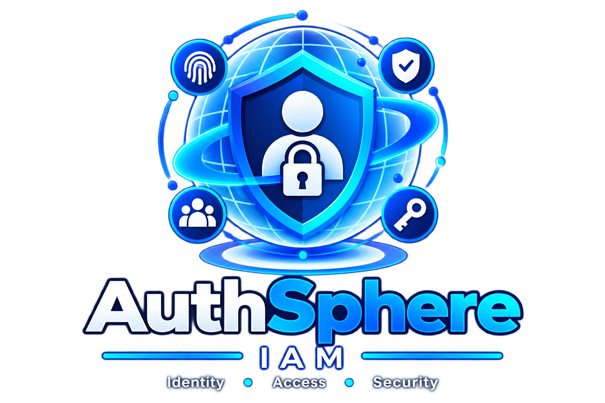

<p align="center">
  
</p>

<h1 align="center">AuthSphere-IAM</h1>

<p align="center">
  A modular Identity and Access Management platform for secure authentication,
  authorization, and application security.
</p>


---

## Overview

AuthSphere is a modular Identity and Access Management (IAM) platform
designed to provide secure and centralized identity, authentication,
authorization, and account security capabilities for modern applications.

---
## Core Capabilities

### Authentication

- User registration
- Email verification
- Password hashing
- Password strength validation
- JWT-based authentication
- Login
- Logout foundation
- Forgot password
- Password reset
- Change password
- Account status management

### Login Security

- Login attempt tracking
- IP address tracking
- Failed login detection
- Account lockout
- Progressive lockout duration
- Automatic lock expiration
- Failed-attempt reset after successful authentication

### Multi-Factor Authentication (MFA)

- TOTP-based Multi-Factor Authentication
- Authenticator app enrollment
- QR code-based MFA setup
- Manual MFA setup key
- 6-digit TOTP verification
- MFA enablement verification
- MFA-protected login flow
- MFA challenge tokens
- MFA challenge expiration
- MFA challenge replay protection
- Invalid and expired MFA challenge handling

### Session Management

- Authenticated session creation
- JWT session identification
- Active session tracking
- Session expiration
- Session activity tracking
- Session revocation
- Logout current session
- Logout all sessions

#### Session Management (Upcoming added in  future)

- Active session management UI
- Device and browser identification
- Session location information
- Session termination from other devices
- Advanced session monitoring

### Security Events

- Centralized security event recording
- Successful login events
- Failed login events
- User and IP association
- Event timestamps
- Security event details

### Planned IAM Capabilities

- Role-Based Access Control (RBAC)
- Permission management
- Organization and multi-tenancy
- Application/client management
- Audit logging
- Security monitoring
- Risk and threat detection
- Administrative security dashboard

---

## Architecture

AuthSphere follows a modular IAM architecture.

```text
                         AuthSphere IAM
                               |
          +--------------------+--------------------+
          |                    |                    |
          v                    v                    v
    Authentication       Authorization          Security
          |                    |                    |
     JWT / Password       Roles / Permissions   Login Security
     Verification              RBAC             Security Events
          |                    |                    |
          +--------------------+--------------------+
                               |
                               v
                           PostgreSQL
```

### Authentication Flow

``` 

                  Client Application
                         |
                         v
                     AuthSphere
                         |
                         v
                      Login
                         |
                         +----> Verify User
                         |
                         +----> Verify Password
                         |
                         +----> Check Account Status
                         |
                         +----> Check Account Lock
                         |
                         v
                     Generate JWT
                         |
                         v
                  Authenticated Client

```

### Session Management Flow

```

                    Login Request
                          |
                          v
                  Authenticate User
                          |
                          v
                   Create Session
                          |
                          v
                    Save Session
                    in PostgreSQL
                          |
                          v
                     Generate JWT
                    with Session ID
                          |
                          v
                    Authenticated
                       Client
                          |
                          v
                   Request with JWT
                          |
                          v
                   Validate JWT
                          |
                          v
                 Extract Session ID
                          |
                          v
                    Find Session
                          |
                          v
              Check Session Status
                    /          \
                 ACTIVE       REVOKED/
                   |           EXPIRED
                   v              |
          Update Last Activity    v
                   |           Reject
                   v              |
             Authenticate        401
               Request

```


### Login Security Flow

```

              Login Request
                    |
                    v
              Find User
                    |
                    v
              Check Account Lock
                    |
                    v
              Verify Password
                 /          \
              Wrong         Correct
                |              |
                v              v
              Record         Record
              Failed         Success
              Attempt        Attempt
                |              |
                v              v
              Update         Reset
              Lockout        Counter
                |              |
                +------+-------+
                       |
                       v
                 Security Event
```

### MFA Flow

```text
                    ┌─────────────────────┐
                    │   User Registration │
                    └──────────┬──────────┘
                               │
                               ▼
                    ┌─────────────────────┐
                    │   Email Verification│
                    └──────────┬──────────┘
                               │
                               ▼
                    ┌─────────────────────┐
                    │   Password Login    │
                    └──────────┬──────────┘
                               │
                     MFA Enabled?
                        /           \
                      No             Yes
                      │               │
                      ▼               ▼
               ┌────────────┐  ┌────────────────┐
               │ Issue JWT  │  │ Create MFA     │
               │   Token    │  │ Challenge      │
               └─────┬──────┘  └───────┬────────┘
                     │                  │
                     │                  ▼
                     │          ┌────────────────┐
                     │          │ MFA Verification│
                     │          │     Page        │
                     │          └───────┬────────┘
                     │                  │
                     │          Enter 6-digit
                     │          TOTP code
                     │                  │
                     │                  ▼
                     │          ┌────────────────┐
                     │          │ Verify TOTP +  │
                     │          │ Challenge Token│
                     │          └───────┬────────┘
                     │                  │
                     │             Valid?
                     │             /      \
                     │           No        Yes
                     │           │          │
                     │           ▼          ▼
                     │       Show Error   Issue JWT
                     │                      │
                     └──────────────┬───────┘
                                    │
                                    ▼
                         ┌────────────────────┐
                         │ Authenticated User │
                         └────────────────────┘
```
### MFA Enrollment Flow

``` text
Authenticated User
        │
        ▼
MFA Setup
        │
        ▼
Backend Generates TOTP Secret
        │
        ├───────────────┐
        ▼               ▼
   QR Code         Manual Setup Key
        │               │
        └───────┬───────┘
                ▼
      Authenticator App
                │
                ▼
        6-Digit TOTP Code
                │
                ▼
        Verify & Enable MFA
                │
                ▼
          MFA Enabled
```


### Technology Stack

| Technology        | Purpose                         |
| ----------------- | ------------------------------- |
| Java              | Backend programming language    |
| Spring Boot       | Application framework           |
| Spring Security   | Security framework              |
| Spring Data JPA   | Data persistence                |
| Hibernate         | ORM                             |
| PostgreSQL        | Relational database             |
| JWT               | Authentication tokens           |
| Maven             | Dependency and build management |
| Swagger / OpenAPI | API documentation and testing   |
| Lombok            | Boilerplate reduction           |


### Security Design

AuthSphere follows several security principles:

      Passwords are stored using secure one-way hashing.
      Authentication failures are tracked.
      Accounts can be temporarily locked after repeated failed attempts.
      Login attempts record the originating IP address.
      Security events provide a centralized security activity trail.
      JWTs are used for authenticated API access.
      Authentication and authorization are treated as separate concerns.

Security-related functionality will continue to expand as the platform develops.


### API Documentation

During development, APIs can be tested using the project's Swagger/OpenAPI interface.

    http://localhost:8081/swagger-ui/index.html

The API documentation is intended for local development and testing.


### Current Implementation Status

AuthSphere is currently under active development.

The following capabilities have been implemented and tested:

#### Authentication

- User registration
- Email verification
- Password hashing
- Password strength validation
- JWT-based authentication
- Login
- Logout
- Forgot password
- Password reset
- Change password
- Account status management

#### Login Security

- Login attempt tracking
- IP address tracking
- Failed login detection
- Account lockout
- Progressive lockout duration
- Automatic lock expiration
- Failed-attempt reset after successful authentication

#### Security Events

- Centralized security event recording
- Successful login events
- Failed login events
- User and IP association
- Event timestamps
- Security event details

#### Session Management

- Authentication session creation
- Session persistence using PostgreSQL
- Session status management
- JWT-to-session binding
- Session validation during authenticated requests
- Session expiration detection
- Session activity tracking
- Individual session logout
- Logout from all sessions
- Session revocation
- Invalid JWT handling
- Revoked-session access prevention

#### Multi-Factor Authentication (MFA)

- TOTP-based Multi-Factor Authentication
- Authenticator app enrollment
- QR code-based MFA setup
- Manual MFA setup key
- 6-digit TOTP verification
- MFA enablement verification
- MFA-protected login flow
- MFA challenge token generation
- MFA challenge expiration
- MFA challenge replay protection
- Invalid MFA code handling
- Invalid MFA challenge handling
- Expired MFA challenge handling

### Planned IAM Capabilities

The following capabilities are planned as AuthSphere continues to evolve:

- Role-Based Access Control (RBAC)
- Permission management
- Organization and multi-tenancy
- Application/client management
- Advanced session policies
- Session management dashboard
- Audit logging
- Security monitoring
- Risk and threat detection
- Administrative security dashboard

### Database

AuthSphere currently uses PostgreSQL for persistent identity and security data.

The database contains domain-specific structures for areas such as:

      Users
      Login Attempts
      Verification Tokens
      Password Reset Tokens
      Security Events

Additional structures will be introduced for:

      Organizations
      Roles
      Permissions
      Applications
      Sessions
      MFA
      Audit Records

as the corresponding modules are implemented.

### Development Workflow

AuthSphere is developed incrementally using the following workflow:

                            Understand
                                |
                                v
                              Design
                                |
                                v
                            Implement
                                |
                                v
                              Test
                                |
                                v
                            Verify Database / API
                                |
                                v
                              Commit
                                |
                                v
                               Push
### Security Testing

Security-related functionality is tested at both the API and database levels.

Examples include:

      Successful authentication
      Invalid credentials
      Repeated failed authentication
      Account lockout
      Lock expiration
      Login after account unlock
      Security-event creation
      Password reset workflows
      JWT generation

Additional automated tests will be introduced as the project matures.


### Project Status

AuthSphere-IAM is currently under active development.

The authentication foundation, login-security mechanisms, Multi-Factor Authentication (MFA), session management, and initial security-event infrastructure have been implemented and tested.

The project is progressing toward a broader IAM platform covering authentication, MFA, RBAC, organizations, application integration, advanced session management, security monitoring, audit logging, and risk detection.


### Future Vision

The long-term objective is for AuthSphere to provide reusable IAM capabilities to multiple applications.

                       AuthSphere IAM
                              |
          +-------------------+-------------------+
          |                   |                   |
          v                   v                   v
      Company A           Company B           Company C
          |                   |                   |
       App A1               App B1               App C1
       App A2               App B2               App C2

Applications can eventually rely on AuthSphere for centralized identity, authentication, authorization, and security capabilities instead of implementing these mechanisms independently.


## License

License information will be added before the first stable release.
